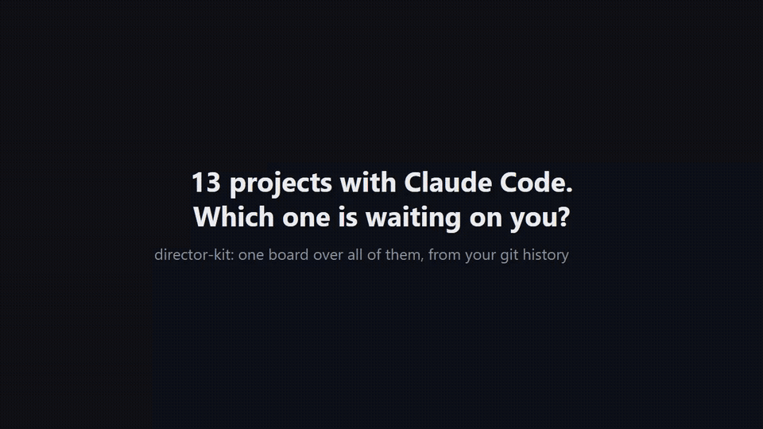

# director-kit

**One person, 214 projects, 3,790 commits in 30 days: the whole operating system is open.**

<sup>Counted by `director-kit board` on the author's machine on 23 Oct 2026; worktrees share history, so each commit is counted once. Run it on yours.</sup>

<!-- refresh both numbers and the date from a live `director-kit board` on release day, never type them by hand -->

director-kit is the core of how I run every project with Claude Code: one board over all of them, and a protocol that makes every session resume exactly where the last one stopped and never redo finished work.

```
npx director-kit
```

Five minutes later you see a board of everything in your projects folder: what waits on you, what is active, what stalled, what is not backed up. It works on day zero, from git history alone. Nothing leaves your machine.



70-second walkthrough on sample data ([mp4](docs/screencast/director-kit.mp4)). Still screenshot: [docs/board.png](docs/board.png).

## What is inside

| Part | What it does |
|---|---|
| **Board** | `~/.director-kit/board.html`, one static file. Columns: waiting on you, active, stalled, paused, done, dormant. Every card: task, next step, blocker, days silent, commits, risks. |
| **Audit** | `director-kit audit`: markdown report. Waiting on you first, then stalled, then repos without a remote, unpushed or uncommitted work, memory indexes over their limit, stale backups. |
| **CHECKPOINT protocol** | `CHECKPOINT.md` in each project: STATUS, TASK, LAST_ACTION, NEXT, DO_NOT_REDO, VERIFY_BEFORE_ACT. A SessionStart hook shows it to Claude before it acts. After compaction or a crash the session continues instead of starting over. |
| **Memory floors** | Index under 6000 chars, topic files, archive. Never delete, move. Test memory before and after compressing it. |
| **Backup watch** | `director-kit backup add <folder>`: the audit flags any backup whose newest file is older than the limit (26 h by default). |
| **Templates** | `SOUL.md` (how the assistant behaves, what needs your yes), `VISION.md` (goal, criteria, constraints), `MEMORY.md`, `CHECKPOINT.md`. |

## Install

Board and audit (Node 18+, git):

```
npx director-kit            # asks for your projects folder, builds the board, opens it
npx director-kit audit
```

Claude Code plugin (protocol, hook, `/director-kit:audit`, `/director-kit:board`, `/director-kit:checkpoint`):

```
claude plugin marketplace add devladpopov/director-kit
claude plugin install director-kit@director-kit
```

## How status is decided

A project is any subfolder with `.git` or `CHECKPOINT.md`.

- With a CHECKPOINT: `STATUS` decides. `NEXT: await user input` puts it in **waiting on you**. In progress but silent longer than 7 days: **stalled**.
- Without one: commits or edits in the last 7 days: **active**; 7 to 30 days: **stalled**; older: **dormant**.
- Worktrees share history, so a commit is counted once.

Limits live in `~/.director-kit/config.json`:

```json
{
  "root": "/home/me/Projects",
  "activeDays": 7,
  "dormantDays": 30,
  "memoryIndexLimit": 6000,
  "backups": [{ "name": "photos to NAS", "path": "/mnt/nas/photos", "maxAgeHours": 26 }]
}
```

## Commands

```
director-kit [root]           first run: pick folder, build board, open it
director-kit board            rebuild the board
director-kit audit            markdown audit, saved to ~/.director-kit/audits/
director-kit checkpoint [dir] create CHECKPOINT.md from the template (never overwrites)
director-kit doctor           check node, git, claude
director-kit demo             board with sample data (~/.director-kit/demo/, for screenshots)
director-kit backup add <path> [--name=nas] [--max-age=26]   watch a backup folder
director-kit backup list | rm <name>                          OK / STALE per folder
  --no-open  --json  --private (no absolute paths)  --root=<dir>
```

## Privacy

The board is a local file. No telemetry, no network calls, no dependencies. `--private` strips absolute paths if you want to share a screenshot.

## Want it set up for you?

The full system also runs every project from Telegram topics with Claude, auto-resume and a director that audits all topics every 8 hours. That part is a done-for-you install: {INSTALL_LINK}.

MIT
