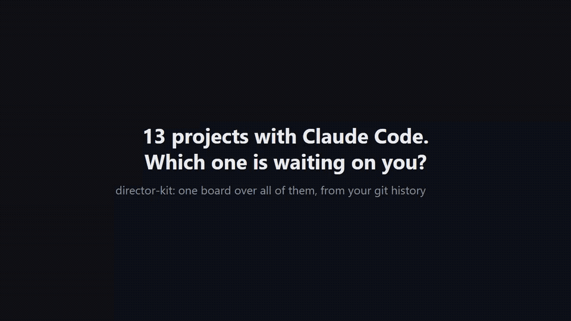

# director-kit

[English](README.md)

**Один человек, 274 проекта, 2 478 коммитов за 30 дней: вся операционная система открыта.**

<sup>Посчитано `director-kit board` на машине автора 31.10.2026. Worktree делят историю, поэтому каждый коммит считается один раз. Запустите у себя.</sup>

director-kit это ядро того, как я веду все проекты с Claude Code. Внутри одна доска над всеми проектами и протокол, по которому каждая сессия продолжает ровно с того места, где остановилась прошлая, и не переделывает готовое.

```
npx director-kit
```

Через пять минут у вас доска по всей папке с проектами: что ждёт вашего решения, что в работе, что застряло, что не забэкаплено. Работает с первого дня, по одной истории git. Ничего не уходит с вашей машины.



Ролик на 70 секунд на выдуманных данных ([mp4](docs/screencast/director-kit.mp4)). Скриншот: [docs/board.png](docs/board.png).

## Что внутри

| Часть | Что делает |
|---|---|
| **Доска** | `~/.director-kit/board.html`, один статичный файл. Колонки: ждёт вас, в работе, застряло, на паузе, готово, спит. На каждой карточке: задача, следующий шаг, блокер, сколько дней тишины, коммиты, риски. |
| **Аудит** | `director-kit audit`: отчёт в markdown. Сначала то, что ждёт вас, потом застрявшее, потом репозитории без remote, незапушенная и незакоммиченная работа, индексы памяти сверх лимита, протухшие бэкапы. |
| **Протокол CHECKPOINT** | `CHECKPOINT.md` в каждом проекте: STATUS, TASK, LAST_ACTION, NEXT, DO_NOT_REDO, VERIFY_BEFORE_ACT. Хук SessionStart показывает его Claude до первого действия. После сжатия контекста или падения сессия продолжает работу, а не начинает заново. |
| **Этажи памяти** | Индекс до 6000 знаков, тематические файлы, архив. Ничего не удалять, только переносить. Проверять память тестом до и после сжатия. |
| **Сторож бэкапов** | `director-kit backup add <папка>`: аудит отмечает бэкап, у которого самый свежий файл старше лимита (по умолчанию 26 часов). |
| **Шаблоны** | `SOUL.md` (как ведёт себя ассистент и на что нужно ваше «да»), `VISION.md` (цель, критерии, ограничения), `MEMORY.md`, `CHECKPOINT.md`. |

## Установка

Доска и аудит (Node 18+, git):

```
npx director-kit            # спросит папку с проектами, построит доску и откроет её
npx director-kit audit
```

Плагин для Claude Code (протокол, хук, `/director-kit:audit`, `/director-kit:board`, `/director-kit:checkpoint`):

```
claude plugin marketplace add devladpopov/director-kit
claude plugin install director-kit@director-kit
```

Видео-гайд из шести шагов, от установки до ежедневного аудита, в кадре только реальный вывод: [docs/GUIDE.md](docs/GUIDE.md) (на английском).

Пошагово для Windows, macOS, Linux и WSL, ежедневный аудит по расписанию, удаление и частые проблемы: [docs/INSTALL.md](docs/INSTALL.md) (на английском). Готовые CHECKPOINT для каждой колонки, пример конфига и CLAUDE.md, с которым Claude соблюдает протокол даже без плагина: [examples/](examples/).

## Как определяется статус

Проект: любая подпапка с `.git` или `CHECKPOINT.md`.

- Есть CHECKPOINT: решает `STATUS`. `NEXT: await user input` или `BLOCKER: you: ...` переносит карточку в **ждёт вас**. `NOT_BEFORE` в будущем: **на паузе** до этого времени. В работе, но тишина дольше 7 дней: **застряло**. `WAIT_FOR` показывается на карточке: кого или что ждёт работа.
- Нет CHECKPOINT: коммиты или правки за последние 7 дней: **в работе**; от 7 до 30 дней: **застряло**; дольше: **спит**.
- Worktree делят историю, поэтому коммит считается один раз.

Пороги лежат в `~/.director-kit/config.json`:

```json
{
  "root": "/home/me/Projects",
  "activeDays": 7,
  "dormantDays": 30,
  "memoryIndexLimit": 6000,
  "backups": [{ "name": "photos to NAS", "path": "/mnt/nas/photos", "maxAgeHours": 26 }]
}
```

## Команды

```
director-kit [root]           первый запуск: выбрать папку, построить доску, открыть
director-kit board            перестроить доску
director-kit audit            аудит в markdown, сохраняется в ~/.director-kit/audits/
director-kit checkpoint [dir] создать CHECKPOINT.md из шаблона (существующий не трогает)
director-kit doctor           проверить node, git, claude
director-kit version          показать версию
director-kit demo             доска на выдуманных данных (~/.director-kit/demo/, для скриншотов)
director-kit backup add <path> [--name=nas] [--max-age=26]   следить за папкой бэкапа
director-kit backup list | rm <name>                          OK / STALE по каждой папке
  --no-open  --json  --private (без абсолютных путей)  --root=<dir>
```

## Приватность

Доска это локальный файл. Без телеметрии, без сетевых запросов, без зависимостей. `--private` убирает абсолютные пути, если хотите показать скриншот.

## Хотите, чтобы всё настроили за вас?

Полная система ещё и ведёт каждый проект из топиков Telegram с Claude: автопродолжение после сбоев и директор, который каждые 8 часов проверяет все топики. Эту часть я ставлю под ключ: https://shtab.vladislavpopov.ru.

MIT
