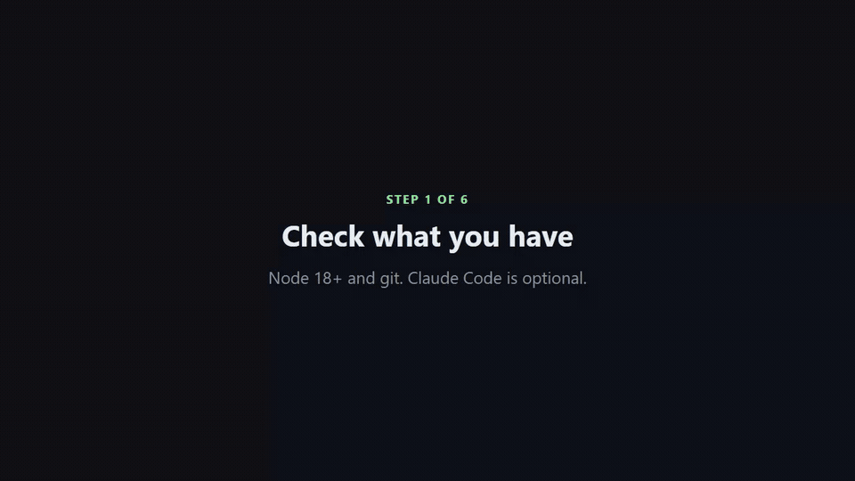
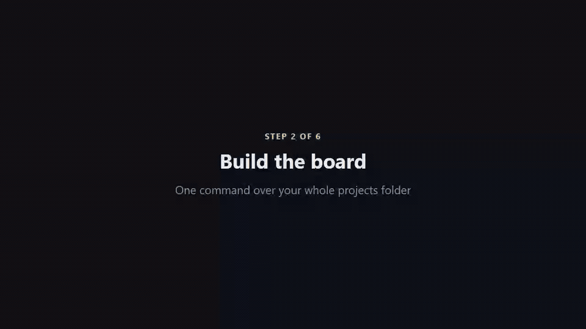
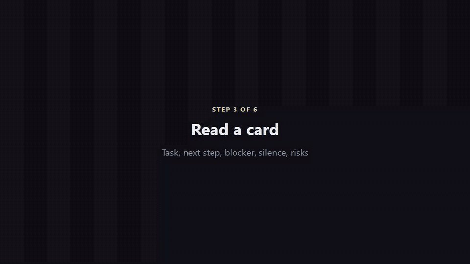
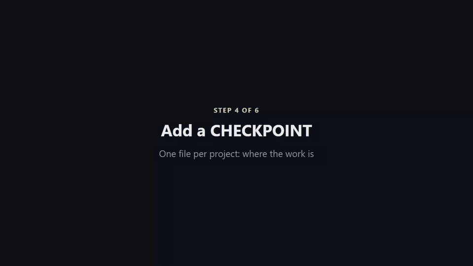
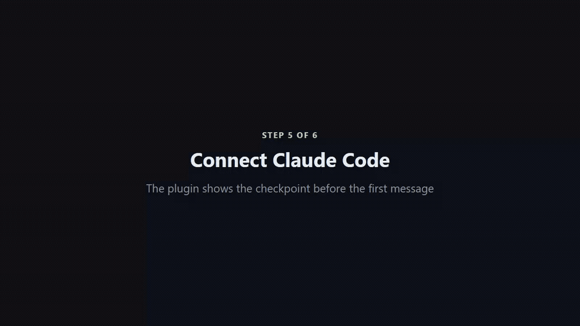
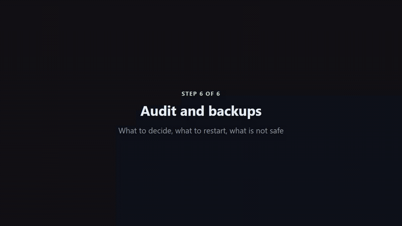

# director-kit in 6 steps

A three-minute video guide, one clip per step. Everything in the terminal is real output of director-kit, recorded on a sample projects folder built from [examples/checkpoints](../examples/checkpoints). Full video with all steps: [guide/director-kit-guide.mp4](guide/director-kit-guide.mp4).

## 1. Check what you have



```
npx director-kit doctor
```

Node 18+ is required, git is needed to see projects without a `CHECKPOINT.md`, Claude Code is optional. Platform notes: [INSTALL.md](INSTALL.md).

## 2. Build the board



```
npx director-kit --root=~/Projects
```

The folder is asked once and saved to `~/.director-kit/config.json`. The board is one static file, `~/.director-kit/board.html`; nothing is uploaded. On day one, without any checkpoints, status comes from git: commits in the last 7 days are active, 7 to 30 days stalled, older dormant.

## 3. Read a card



A card shows the task, the next step and the blocker from `CHECKPOINT.md`, days of silence, commits in 30 days and risks in red: no remote, unpushed commits, files left uncommitted for days. `NOT_BEFORE` keeps a scheduled project in Paused instead of Stalled, `WAIT_FOR` says who the work is waiting on. The filter searches names, tasks and next steps.

## 4. Add a CHECKPOINT



```
director-kit checkpoint ~/Projects/crm-lite
```

Creates the file from the template and never overwrites an existing one. Claude rewrites it after each significant step. `NEXT: await user input` or `BLOCKER: you: ...` moves the card to Waiting on you, with your exact question on it.

## 5. Connect Claude Code



```
claude plugin marketplace add devladpopov/director-kit
claude plugin install director-kit@director-kit
```

The SessionStart hook puts the checkpoint in front of Claude before your first message: status, next step, what must not be redone, how to verify state. In a project with `STATUS: COMPLETED` it tells Claude not to repeat the work. Without the plugin, the same rules fit in a CLAUDE.md: [examples/CLAUDE.md](../examples/CLAUDE.md).

## 6. Audit and backups



```
director-kit backup add ~/Backups/nas --name=nas --max-age=26
director-kit audit
```

The audit lists what waits on you first, then stalled projects, repos that are not safe, projects without a checkpoint, memory files over the limit and stale backups. Run it daily: Task Scheduler on Windows, cron on macOS and Linux, commands in [INSTALL.md](INSTALL.md#daily-audit-on-a-schedule).

## Re-recording

`node docs/guide/record-guide.mjs` records the six clips with Playwright, `bash docs/guide/build.sh [music.mp3]` makes the GIFs and the full video.
